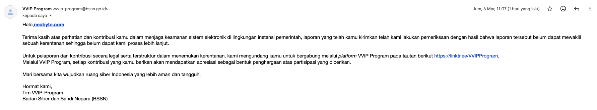
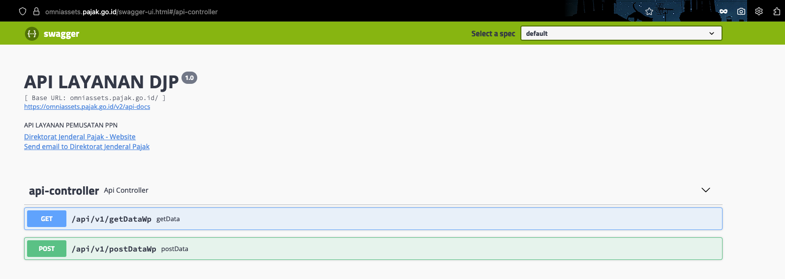
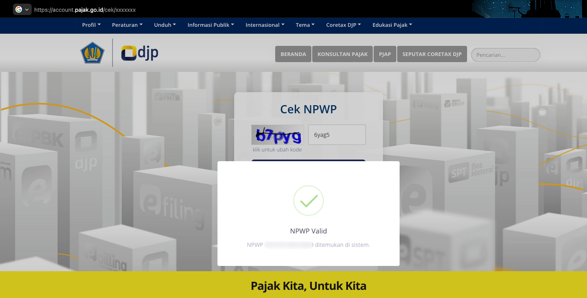

# NPWP Validator

Validasi format NPWP (15 digit) dan fetch data Wajib Pajak dari API DJP `getDataWp` (omniassets.pajak.go.id). Format NPWP sudah divalidasi sesuai aturan; untuk validasi keberadaan/status WP gunakan API atau layanan resmi (mis. BSSN).

## Disclaimer — Risiko Eskalasi Siber & Tanggung Jawab

API DJP `omniassets.pajak.go.id` adalah **API publik** (tanpa autentikasi). **BSSN telah memvalidasi laporan terkait dan menyatakan ini bukan bug.** Meskipun demikian, respons API (FOUND / NOT FOUND) dapat dipakai untuk eskalasi penyalahgunaan siber. **Saya sebagai pemilik repo ini tidak bertanggung jawab atas penyalahgunaan tersebut. Segala tanggung jawab penuh berada di tangan BSSN yang memvalidasi laporan saya.**

### Bukti: Respons API Hanya Mengembalikan Status, Tanpa Data Identitas

Siapa pun dapat memanggil API dan hanya mendapat konfirmasi “terdaftar” atau “tidak terdaftar” (tanpa nama, alamat, dll.):

```bash
curl -s -H 'Accept: application/json' 'https://omniassets.pajak.go.id/api/v1/getDataWp?npwp=<REDACTED>'
```

**Contoh respons (NPWP terdaftar):**

```json
{ "kd_status": "1", "status": "FOUND", "message": "Data Identitas WP Ditemukan" }
```

**Contoh respons (NPWP tidak terdaftar):**

```json
{ "kd_status": "0", "status": "NOT FOUND", "message": "Data Identitas WP Tidak Ditemukan" }
```

Tidak ada field nama, alamat, atau data pribadi lain. Yang “bocor” adalah **informasi biner**: NPWP ini valid di sistem DJP atau tidak. Informasi itu saja dapat dieksploitasi seperti di bawah.

### Bentuk Eskalasi yang Dapat Membahayakan

1. **Social engineering**
   Pelaku mengecek NPWP korban lewat API → dapat `FOUND`. Saat telepon/WA/email mengaku dari DJP: _“NPWP Bapak/Ibu terdaftar. Ada kendala administrasi, silakan transfer ke rekening ini / kirim OTP / klik link verifikasi.”_ Korban lebih percaya karena NPWP-nya memang terdaftar → tingkat keberhasilan penipuan naik.

2. **Enumerasi + data lain**
   Pelaku menguji banyak nomor NPWP (brute/list) → mendapat daftar NPWP yang valid. Daftar itu digabung dengan data bocor (nama, HP, email, NIK) → cocokkan identitas. Hasil: target jelas untuk phishing, impersonation, atau penipuan berkedok pajak/fintech.

3. **Penipuan KYC / pinjaman**
   Form pinjaman atau registrasi hanya mengecek “apakah NPWP valid”. Pelaku memakai identitas orang lain + NPWP yang sudah dicek `FOUND` → lolos validasi “NPWP terdaftar”. Dapat dipakai untuk fraud aplikasi pinjaman atau layanan yang mengandalkan cek NPWP saja.

4. **Credential stuffing / account takeover**
   NPWP dipakai sebagai identifier (atau bagian login) di aplikasi pajak/fintech. Pelaku punya daftar NPWP valid dari enumerasi API → fokus mencoba password/akun hanya untuk NPWP yang “hidup”. Risiko takeover akun lebih terarah.

5. **Doxing / targeting**
   Pelaku sudah punya NPWP seseorang (dari dalam atau beli data). Cek ke API → `FOUND` = konfirmasi orang itu ada di sistem DJP. Dipakai untuk memastikan target sebelum ancam, harass, atau jual data “verified”.

**Referensi terkait eskalasi:**

- [OWASP – User Enumeration](https://owasp.org/www-project-web-security-testing-guide/latest/4-Web_Application_Security_Testing/03-Identity_Management_Testing/04-Testing_for_Account_Enumeration_and_Guessable_User_Account) — pengujian enumerasi akun/identitas.
- [CISA – Credential Stuffing](https://www.cisa.gov/news-events/news/avoiding-social-engineering-and-phishing-attacks) — penggunaan kredensial bocor untuk takeover akun.
- [NIST – Identity Proofing](https://pages.nist.gov/800-63-3/sp800-63a.html) — validasi identitas dan risiko jika hanya mengandalkan satu faktor (mis. cek NPWP saja).

Dengan menggunakan repo atau API ini, Anda setuju bahwa pemilik repo **tidak bertanggung jawab** atas eskalasi penyalahgunaan di atas; tanggung jawab ada pada pihak yang berwenang (BSSN) yang telah memvalidasi status API tersebut. **Penggunaan repo dan API ini sepenuhnya menjadi tanggung jawab pengguna (use at your own risk).** Dengan mengakses, mengunduh, atau memakai kode/API ini, Anda dianggap telah menyetujui bahwa pemilik repo tidak bertanggung jawab atas segala dampak atau kerugian yang timbul.

### Referensi (Preview)

**Bukti validasi BSSN** (pernyataan bahwa API publik bukan bug):



**UI Swagger DJP** (omniassets.pajak.go.id):



**Fitur Cek NPWP resmi DJP** (account.pajak.go.id) dengan CAPTCHA:



---

## Install

```bash
git clone https://github.com/NeaByteLab/NPWP-Validator
cd NPWP-Validator
```

Import dari path lokal (atau pasang import map ke `./src/index.ts`):

```ts
import { NpwpClient } from './src/index.ts'
```

## Usage

### Fetch Data WP dari API DJP

Endpoint: `https://omniassets.pajak.go.id/api/v1/getDataWp?npwp=<nomor>`

```ts
import { NpwpClient } from './src/index.ts'

const result = await NpwpClient.getDataWp('12.345.678.9-012.345')

if (result.ok && result.data) {
  console.log(result.data.status, result.data.message)
} else {
  console.log(result.message)
}
```

NPWP bisa diberi dengan atau tanpa pemisah (titik/strip); akan dinormalisasi ke 15 digit sebelum request.

### POST Data WP (postDataWp)

Kirim body JSON ke `/api/v1/postDataWp`. Isi body tidak didokumentasikan di Swagger; minimal kirim `npwp`.

**Response dari API (hasil curl):**

- **Body berisi NPWP** (mis. `{ "npwp": "123456789012345" }`): format sama seperti GET — `kd_status`, `status`, `message`. Contoh: `status: "NOT FOUND"`, `message: "Data Identitas WP Tidak Ditemukan"`.
- **Body kosong atau invalid** (mis. `{}`): format lain — `status: "error"`, `code`, `error_msg`, `timestamp`.

```ts
const result = await NpwpClient.postDataWp({ npwp: '123456789012345', nama: '...' })
if (result.ok) {
  // HTTP 2xx; cek result.data.status / result.data.message
} else {
  // network/parse error atau result.data.status === 'error'
  console.log(result.message ?? (result.data?.error_msg as string))
}
```

## API DJP (Swagger)

- **Swagger UI:** [omniassets.pajak.go.id/swagger-ui.html](https://omniassets.pajak.go.id/swagger-ui.html)
- **OpenAPI JSON:** [v2/api-docs](https://omniassets.pajak.go.id/v2/api-docs) — \_API Layanan Pemusatan PPN

| Method | Path                             | Deskripsi                                           |
| ------ | -------------------------------- | --------------------------------------------------- |
| GET    | `/api/v1/getDataWp?npwp=<nomor>` | Ambil data WP (query `npwp` required)               |
| POST   | `/api/v1/postDataWp`             | Post data (body JSON, `consumes: application/json`) |

Response umum: 200 OK, 401 Unauthorized, 403 Forbidden, 404 Not Found.

## API (Library)

- **`NpwpClient`** (static class)
  - `getDataWp(npwp: string, base?: string): Promise<GetDataWpResult>` — GET data WP. NPWP boleh dengan atau tanpa pemisah; dinormalisasi ke 15 digit sebelum request. Default base: `https://omniassets.pajak.go.id`.
  - `postDataWp(requestBody: Record<string, unknown>, base?: string): Promise<PostDataWpResult>` — POST body JSON ke postDataWp.

Format validation dan decode NPWP (15 digit) tersedia di `./src/Validator.ts` (`NpwpValidator`) dan tipe di `./src/Types.ts` bila diperlukan di luar client.

## License

This project is licensed under the MIT license. See the [LICENSE](LICENSE) file for details.
